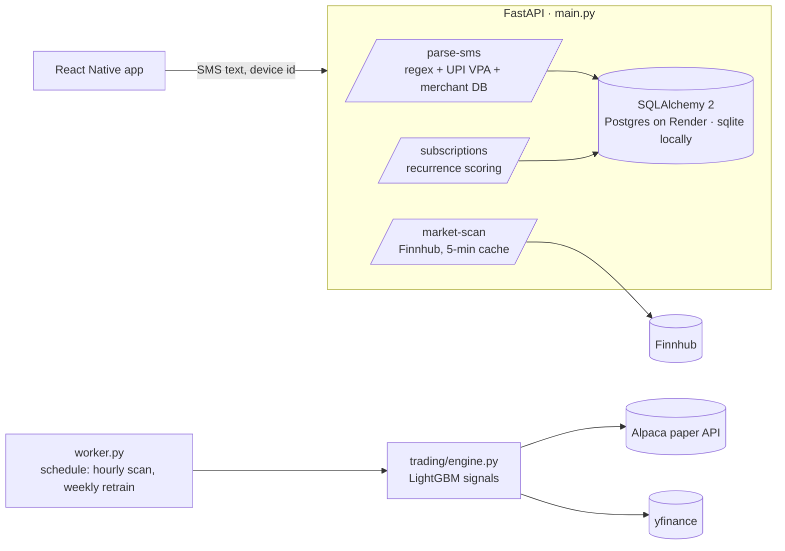

# LifePilot Backend

[](https://github.com/hardik656/lifepilot-backend/actions/workflows/ci.yml)


Backend for **LifePilot**, a React Native app that reads bank/UPI SMS alerts, detects recurring
subscriptions, helps users cancel them, and suggests investing the money saved. A separate worker
runs an ML-driven paper-trading bot on Alpaca.

## Architecture



- **API service** (`main.py`): SMS parsing, subscription detection, per-device data isolation
  (`x-device-id`), rate limiting, merchant cancellation catalogue (`merchants.json`), market scan.
- **Worker service** (`worker.py` + `trading/engine.py`): feature engineering, LightGBM models
  retrained weekly, bracket orders on Alpaca **paper** trading.
- **Persistence**: SQLAlchemy 2 (`database.py`), `DATABASE_URL` from env, Render `postgres://` URLs normalised.

## Run locally

```bash
python -m venv .venv && source .venv/bin/activate
pip install -r requirements.txt -r requirements-dev.txt
cp .env.example .env   # add FINNHUB_API_KEY / ALPACA_* if you need those features
uvicorn main:app --reload            # API on http://localhost:8000/docs
python worker.py                     # trading worker (needs ALPACA_API_KEY + ALPACA_SECRET_KEY)
```

Docker: `docker build -t lifepilot-backend . && docker run -p 8000:8000 --env-file .env lifepilot-backend`

## Configuration

All secrets are read from environment variables; see [`.env.example`](.env.example).

| Variable | Used by |
|---|---|
| `DATABASE_URL` | API (defaults to local sqlite) |
| `FINNHUB_API_KEY` | `/market-scan` (returns 503 if unset) |
| `ALPACA_API_KEY`, `ALPACA_SECRET_KEY`, `ALPACA_PAPER` | worker (trading disabled if unset) |
| `SENTRY_DSN` | error reporting (optional) |

## Tests

```bash
pytest --cov=.     # API tests on a throwaway sqlite DB + a guard against hard-coded credentials
ruff check .
pre-commit install # ruff + gitleaks secret scan on every commit
```

## Deploy

`Procfile` defines `web` (uvicorn) and `worker` processes (Render / Heroku style).
See [README_ARCHITECTURE.md](README_ARCHITECTURE.md) for the two-service design notes.
